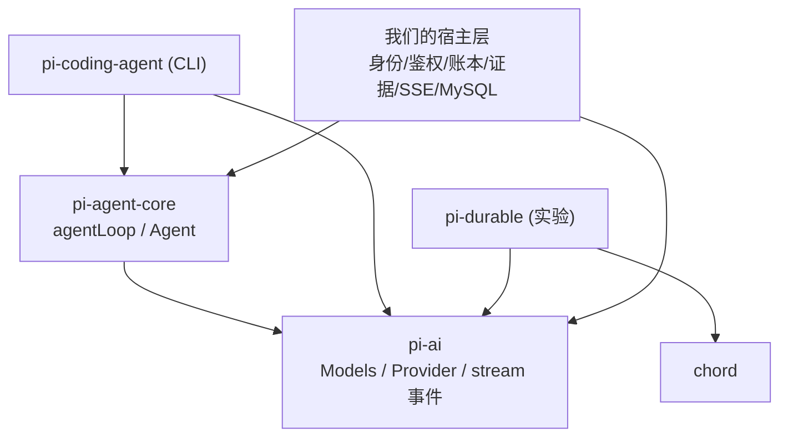

> **版本锁定**：本文与本仓库示例均锁定 pi **v1.2.0**（`@earendil-works/pi-ai@1.2.0`、`@earendil-works/pi-agent-core@1.2.0`）。不要跟 pi 的 main。可运行的 MVP 在 [`src/`](../src/)：`npm run demo`（离线 faux）和 `npm start`（`POST /v1/chat` SSE，SQLite 会话）。下文第 5 节是 Pi 循环摘录，不是当前宿主。这个切片没有网关，也没有鉴权钩子。

# Pi 源码导读（pi-ai + pi-agent-core）——为重写「门店智能客服」准备

日期：2026-10-14 ｜ 配套调研：`pi-buddy-agent-rewrite.md`（这里不再重复其中的结论）

**锁定版本**：`github.com/earendil-works/pi`，tag **v1.2.0**，提交 `06a466935536f8c9bcacb2d5efc0fc021be1bdff`（2026-10-13 06:46 UTC+8）。本文按这个 tag 阅读。当时 main 已比它多出 44 个提交（HEAD `b45e0eb`），下文只按 tag 来读。npm 上 `@earendil-works/pi-ai@1.2.0` 和 `@earendil-works/pi-agent-core@1.2.0` 与此对应。
下文源码路径都相对于 pi 仓库的 `packages/`，不是本仓库路径。本仓库没有内置 pi 源码。

---
## 1. 一页总览

| 包（目录） | npm | 职责 |
|---|---|---|
| `ai` | `@earendil-works/pi-ai` | 统一 LLM API：Provider/Model 目录、鉴权解析、消息与内容类型、流式事件协议、工具 schema（typebox）、token/cost、重试与溢出判断工具、faux 测试 provider |
| `agent` | `@earendil-works/pi-agent-core` | 通用 agent 循环（`agentLoop`/`runAgentLoop`）和有状态的 `Agent` 类：工具执行、钩子、steering/follow-up 队列、事件订阅 |
| `coding-agent` | pi CLI | 编码 agent 运行时，包括会话文件、扩展、压缩、自动重试和 TUI 集成。**我们不用它当运行时**，只作为“怎么用 core”的参考 |
| `durable` | `pi-durable`（实验性） | 持久化 agent harness：先提交、再展示，崩溃后可续跑。依赖 ai + chord |
| `tui` / `mcp` / `codemode` / `chord` / `env` / `telemetry` / `evals` | — | 终端 UI、MCP、code mode、文档状态等，与本项目基本无关 |


pi-agent-core 的依赖只有 `@earendil-works/pi-ai` 和 `typebox`（见 `agent/package.json`）。

---
## 2. pi-ai

### 2.1 模型 / 供应商抽象
- `ai/src/models.ts`
  - `interface Provider`（约第 155 行）：`id`、`auth`、`getModels()`、`stream()`/`streamSimple()`，可选 `refreshModels()`。
  - `interface Models`（约第 255 行）：provider 集合，提供 `getModel(provider,id)`、`stream`/`complete`/`streamSimple`/`completeSimple`、`getAuth`、`checkAuth`。
  - `createModels()`（第 998 行）返回 `MutableModels`，可用 `setProvider`/`deleteProvider` 增删 provider。
  - `createProvider()`（第 1047 行）由身份、auth、模型列表和 API 实现（`api`）组装出一个 Provider。
- **入口文件不带副作用**：`ai/src/index.ts` 里不含任何内置 provider。provider 工厂在子路径 `@earendil-works/pi-ai/providers/*`，API 实现在 `.../api/*`（例如 `openai-completions.lazy`）。旧的全局 API 在 `.../compat`。
- `Model<TApi>`（`ai/src/types.ts` 约第 834 行）是**纯数据**，包括 `id`、`api`、`provider`、`baseUrl`、`cost`（每百万 token 的价格）、`contextWindow`、`maxTokens`、`reasoning`、`thinkingLevelMap`、`compat`，可以直接 JSON 序列化。
- `Api`（`types.ts` 第 61–73 行）就是协议族，如 `"openai-completions"`、`"anthropic-messages"`。Provider 把模型按 `model.api` 分派给对应实现。

### 2.2 消息与内容类型（`ai/src/types.ts` 第 408–640 行）
- 内容块：`TextContent`、`ThinkingContent`（带 `thinkingSignature`、`redacted`）、`ImageContent`（base64）、`ToolCall {id,name,arguments: JsonObject}`。
- 消息：`Message = SystemMessage | UserMessage | AssistantMessage | ToolResultMessage`。
  - **`SystemMessage` 可以出现在 transcript 中间**，并带有 `sections`（按名字替换的提示片段）和 `toolsAdded`/`toolsRemoved`。v1.2 的设计是：系统提示和工具声明都是 transcript 里的系统消息，按顺序重放即可得到当前的提示和工具集。
  - `AssistantMessage` 带有 `api/provider/model`、`usage`、`stopReason`、`errorMessage`、`timestamp`、`durationMs`、`diagnostics`。
- `StopReason = "pending"|"stop"|"length"|"toolUse"|"error"|"aborted"|"deferred"`。
- 两种上下文：`Context {systemPrompt?, messages, tools?}` 是对外入口；`TranscriptContext` 是带 brand 的规范化类型，只有 `normalizeContext()` 能产出（`utils/transcript.ts`），provider 只接受这种。

### 2.3 流式事件（`types.ts` 约第 801 行 `AssistantMessageEvent`）
事件顺序：`start` → `text_start/delta/end`、`thinking_*`、`toolcall_start/delta/end` → `done{reason, message}` 或 `error{reason:"aborted"|"error", error}`。
- 每个事件都带 `partial`。它是一个**会持续增长的共享对象**，不是事件发生时的快照。要存下来就自己拷贝。
- 承载这些事件的是 `AssistantMessageEventStream`（`utils/event-stream.ts`，基类 `EventStream`）。它可以 `for await` 迭代，`result()` 返回最终的 `AssistantMessage`，并自动写入 `durationMs`。

### 2.4 工具定义格式
- `Tool {name, description, parameters: TSchema, constrainedSampling?}`（`types.ts` 约第 749 行）。参数用 typebox 的 `Type.Object(...)` 定义，`index.ts` 会重新导出 `Type`。
- 参数校验在 `utils/validation.ts`（`validateToolArguments`），agent-core 执行工具前会调用它。

### 2.5 DeepSeek 怎么接
- `ai/src/providers/deepseek.ts`：`deepseekProvider()` = `createProvider({id:"deepseek", baseUrl:"https://api.deepseek.com", auth: envApiKeyAuth(..., ["DEEPSEEK_API_KEY"]), api: openAICompletionsApi()})`。
  - **走 OpenAI Chat Completions 协议**，不是旧系统用的 `/anthropic` 端点。
- npm 1.2.0 包里内置的模型（实测 `getModels()`）：
  - `deepseek-flash`：输入 0.3、输出 1.2、cacheRead 0.006（美元/百万 token），上下文 1M。
  - `deepseek-v4-pro`：输入 1.32、输出 3.96。
  - 模型数据在 `providers/data/deepseek.json`，这是生成文件，源码仓库里没有，npm 包里有。
- 思考参数的格式由 `compat.thinkingFormat:"deepseek"` 决定，见 `providers/compat-schema.ts` 第 249–261 行，默认按 URL 自动识别。
- 用法：
  ```ts
  models.setProvider(deepseekProvider());
  models.getModel("deepseek", "deepseek-flash");
  ```
- 百炼的 Anthropic 兼容端点：用 `createProvider` 搭配 `anthropicMessagesApi()`（`api/anthropic-messages.lazy`）。写法参照 README 的 “createProvider()” 一节。
- **多租户 key**：
  - `streamSimple` 的 options 可以直接传 `apiKey`。
  - agent-core 的 `getApiKey(provider)` 在每次请求前都会被调用（`agent-loop.ts` `streamAssistantResponse`）。

### 2.6 取消 / abort
- 给 options 传 `signal: AbortSignal`（`StreamOptions` 继承自 `ProviderRequestOptions`）。
- 被中止的请求以 `error{reason:"aborted"}` 结束，最终消息 `stopReason==="aborted"`，保留已收到的部分内容和 usage。
- 中止后的消息可以直接放回上下文，然后继续对话（README “Continuing After Abort”）。

### 2.7 错误处理
- **约定**：stream 一旦返回就不再 throw，所有失败都编码进流里，以 `error` 事件结束，`stopReason:"error"`，并带上 `errorMessage`。
  - 唯一例外：直接调用 API 实现的 `streamSimple` 且缺少 auth 时，会同步 throw。
  - 见 `types.ts` 中 `StreamFunction` 的注释，以及 README “Error Handling”。
- 工具函数：
  - `utils/retry.ts`：`isRetryableAssistantError`、`retryAssistantCall`、`retryDelayMs`。
  - `utils/overflow.ts`：`isContextOverflow`、`isRecoverableLength`。
- **agent-core 循环本身不做重试**。coding-agent 在 `core/agent-session.ts` 里自己实现了 auto_retry。我们的宿主层也要自己做。

### 2.8 token / cost
- `Usage {input, output, cacheRead, cacheWrite, reasoning?, totalTokens, cost{...,total}}`，见 `types.ts` 约第 446 行。
- 各 API 实现会调用 `calculateCost(model, usage)`（`models.ts` 第 1206 行），例如 `api/openai-completions.ts` 第 1558 行。
- 每条 `AssistantMessage.usage` 都有值。按 run 汇总由宿主层负责。

---
## 3. pi-agent-core

文件：
- `agent/src/types.ts`：全部契约。
- `agent/src/agent-loop.ts`：无状态循环。
- `agent/src/agent.ts`：有状态的 `Agent` 包装。
- `stream-fn.ts`：`setDefaultStreamFn`。
- `proxy.ts`：经代理的 streamFn。

### 3.1 一轮的完整调用链
```
Agent.prompt(text)                                   agent.ts ~373
 └ normalizePromptInput → UserMessage
 └ runPromptMessages → runWithLifecycle(新 AbortController，置 isStreaming)     ~510
    └ runAgentLoop(prompts, createContextSnapshot(), createLoopConfig(), processEvents, signal, streamFn)  agent-loop.ts 102
       emit agent_start, turn_start, 对每条 prompt emit message_start/end
       └ runLoop  (agent-loop.ts 163)
          外层 while(true)（follow-up）
           内层 while(有工具调用 || 有待注入消息)
            1. (非首轮) prepareNextTurn → 轮询 steering → emit turn_start
            2. declareToolChanges：工具集合有变化时插入一条系统消息；待注入消息全部 push 进 context 并 emit
            3. prepareRequest({context, model, thinkingLevel})   ← 每次请求前都会调用，包括第一次
            4. streamAssistantResponse (381):
                 transformContext → convertToLlm → normalizeContext → getApiKey
                 → streamFn(model, llmContext, {...config, apiKey, signal})
                 → start: 把 partial push 进 context，emit message_start
                 → *_delta: 替换最后一条，emit message_update(assistantMessageEvent)
                 → done/error: 替换为最终消息，emit message_end
            5. stopReason 为 error/aborted：finishTurn → turn_end → agent_end → return（硬退出）
            6. 有 toolCall：stopReason==="length" 时全部判失败（failToolCallsFromTruncatedMessage），
               否则 executeToolCalls（sequential/parallel）
               toolResult 消息 push 进 context
            7. finishTurn(turn) → emit turn_end；返回 {action:"end"} 时立即 agent_end
            8. 轮询 steering
           getFollowUpMessages() 有消息就继续外层；finishTurn 要求 continue 时补一次请求
          emit agent_end(newMessages)
 └ finishRun：isStreaming=false，resolve waitForIdle
```
`Agent.processEvents`（agent.ts 末尾）负责归约状态：`message_end` 时把消息 push 进 `state.messages`；`tool_execution_start/end` 时维护 `pendingToolCalls`。之后**按顺序逐个 await 每个 listener**。

### 3.2 工具执行与回填（agent-loop.ts 第 508–948 行）
- `AgentTool extends Tool`，增加了这些字段：`label`、`execute(toolCallId, params, signal, onUpdate)`、`prepareArguments?`、`outputSchema?`、`executionMode?`、`replay?:"never"|"safe"`（types.ts 末尾）。
- `prepareToolCall` 的步骤：
  1. 按 name 查找工具，找不到就返回错误结果。
  2. `prepareArguments`。
  3. `validateToolArguments`。
  4. `beforeToolCall`，返回 `{block:true, reason}` 时生成错误结果，不执行工具。
  5. 检查 abort。
- `executePreparedToolCall`：工具抛出的异常会**变成 `isError:true` 的结果**，不会让循环崩掉。`onUpdate` 触发 `tool_execution_update`，`durationMs` 用单调时钟计时。
- `finalizeExecutedToolCall`：`afterToolCall` 可以逐字段覆盖 content、details、isError、terminate、structuredContent。
- 结果写回为 `ToolResultMessage`（`createToolResultMessage`）。`content` 给模型看；`details` 和 `structuredContent` **不发给模型**，只给 UI 和程序使用，**正好可以放服务端投影卡片的原始数据**。
- 默认 `toolExecution:"parallel"`：先顺序做 preflight，再并发执行。`tool_execution_end` 按完成顺序发出，toolResult 消息按 assistant 中的原始顺序发出。
- `terminate:true`：只有一批工具结果**全部**为 terminate 时才提前结束。
- `runToolCall()` 是导出的：工具内部再调用其他工具时也会经过同样的钩子。

### 3.3 事件 / 订阅
- `AgentEvent`（types.ts 末尾）包括：
  - `agent_start/end`
  - `turn_start/end`
  - `message_start/update/end`：覆盖所有角色，其中 update 只针对 assistant
  - `tool_execution_start/update/end`
- `agent.subscribe((event, signal) => …)` 返回取消订阅的函数。**listener 被逐个 await**，所以 listener 写库的速度会直接拖慢循环。这是一种背压，也是一个可以利用的保证：可以在 `message_end` 里先写库，写完再继续。
- 底层 `agentLoop()` 返回 `EventStream<AgentEvent>`；`runAgentLoop()` 接收一个 `emit` sink。

### 3.4 状态在哪、能否序列化/恢复
- 状态全在 `Agent._state`（`createMutableAgentState`，agent.ts 约第 82 行），包括 `messages`、`tools`、`model`、`thinkingLevel`，以及运行期字段 `isStreaming`/`streamingMessage`/`pendingToolCalls`/`errorMessage`。
  - `systemPrompt` 是只读的，从 transcript 的系统消息重放得到。
  - 要修改提示词，需要追加一条 system 消息。
- **可序列化的只有 `messages`**（实跑 `JSON.stringify(agent.state.messages)` 没问题）。`model` 也是纯数据。`tools` 包含函数，要靠代码重建。
- 恢复方式：
  ```ts
  new Agent({ initialState: { messages, model, tools }, ... })
  ```
  如果最后一条是 user 或 toolResult，调用 `agent.continue()`（agent.ts 约第 384 行）。如果最后一条是 assistant 会 throw，除非队列里还有消息。
- **流到一半崩溃无法续写**：partial 只存在内存里。可行的恢复办法是丢弃 partial，从最后一条已持久化的 user/toolResult 消息处 `continue()` 重新生成。工具若带副作用，按 `replay` 策略处理（core 只声明了这个字段，需要宿主层或 pi-durable 来解释它）。

### 3.5 steering / 中断
- `agent.steer(msg)`：在当前这批工具执行完之后、下一次请求之前注入。不会跳过本批工具。
- `agent.followUp(msg)`：等 agent 本来要停下时再注入。
- `steeringMode`/`followUpMode`：`"one-at-a-time"`（默认）或 `"all"`。
- `agent.abort()` 中止当前 run 的 AbortController，结果是 `stopReason:"aborted"` 并硬退出。
- `agent.waitForIdle()`、`agent.reset()`。
- 当前 run 进行中再调用 `prompt()` 会 throw，提示改用 `steer` 或 `followUp`。

### 3.6 钩子 / 扩展点（`AgentOptions`，agent.ts 约第 114 行；`AgentLoopConfig`，types.ts）
| 钩子 | 时机 | 我们的用途 |
|---|---|---|
| `streamFn`（**必填**） | 每次请求 | `models.streamSimple` 包装：租户 key、指标、审计 |
| `getApiKey(provider)` | 每次请求前 | 按租户取 key |
| `transformContext(msgs, signal)` | 请求前，作用于 AgentMessage 层 | token 预算、裁剪、证据可见性约束 |
| `convertToLlm(msgs)` | 之后 | 把自定义消息转换或过滤成 LLM 消息 |
| `prepareRequest` | 每次请求前，含第一次 | 换模型/上下文；从数据库对齐 |
| `prepareNextTurn(WithContext)` | 轮与轮之间 | 压缩、注入账本摘要 |
| `beforeToolCall` | 参数校验后、执行前 | **工具鉴权、一次性凭证、限流、写“开始”记录** |
| `afterToolCall` | 执行后、写回前 | **证据入账、脱敏、卡片投影、写“结果”并 ACK** |
| `finishTurn` | 每轮末 | 目标账本未完成时返回 `{action:"continue"}`；预算耗尽时返回 `{action:"end"}` |
| `onPayload/onResponse/onProviderStreamEvent` | HTTP 层 | 调试、观测 |
| `CustomAgentMessages` | 类型层面 | 通过声明合并加入自定义消息（如卡片、通知），在 convertToLlm 里过滤掉 |

约定：`transformContext`、`convertToLlm`、`getApiKey`、`getSteeringMessages` 都**不应 throw**。throw 会打断循环，最后由 `Agent.handleRunFailure` 兜底，合成一条 error 消息。

---
## 4. 与宿主层的接缝

| 关注点 | 插在哪 | Pi 管不管 |
|---|---|---|
| 身份 / 租户 | 每个会话一个 `Agent` 实例，租户上下文通过**闭包**捕获到工具 `execute`、钩子和 `getApiKey` 里；需要 metadata 时用 `sessionId` | 不管。Pi 没有用户、租户概念 |
| 工具鉴权 / 一次性凭证 | `beforeToolCall`：服务端签发并校验凭证，`{block:true, reason}`；跨工具调用用 `runToolCall` | 只提供钩子 |
| 租约 / 幂等 / run 状态机 | 完全在宿主层：持有租约后才 `new Agent` 和 `prompt` | 不管 |
| 持久化 | `subscribe` 中 `message_end` 时写 MySQL。listener 被 await，所以写库 ACK 之后循环才继续。toolResult 在 `afterToolCall` 或 `message_end` 时落库 | 不管，只保证消息可 JSON 化 |
| 崩溃恢复 | 从数据库读出 messages，`new Agent({initialState})` 后 `continue()`；partial 丢弃重跑 | 不管；可参考 pi-durable（实验性） |
| SSE 投影 | `subscribe`：把 `message_update.text_delta` 推给客户端，`tool_execution_*` 转成状态事件，卡片取 `details`/`structuredContent` 做服务端投影。`Last-Event-ID` 的事件序号由宿主层分配 | 只提供事件 |
| 目标账本（SaaSState）/ 证据 | `afterToolCall` 入账；`finishTurn` 决定是否继续；`transformContext` 实施可见性约束 | 不管 |
| 上下文预算 | `transformContext` 加上 `usage` 和 `isContextOverflow` | 只提供工具函数 |
| 重试 / 限流 | 包在 `streamFn` 里，或在 run 层检查 `isRetryableAssistantError` | core 不重试 |
| 并发（一个进程多会话） | 每个会话各自一个 `Agent`，互不共享状态。`Models` 实例可以共享（它是 provider 注册表）。注意 `setDefaultStreamFn` 是**模块级全局**，应显式传 `streamFn`。同一个 Agent 不能并发 `prompt`，宿主层要按会话串行 | 单 Agent 单 run；跨会话并发由宿主层调度 |
| 取消 | HTTP cancel 调用 `agent.abort()`；身份或租约失效时也 abort | 支持 |

---
## 5. 最小可跑通示例

下面这段是当时的最小循环摘录，用来对照 Pi 的 API。当前宿主在 `src/`，用 `npm run demo` / `npm start` 跑。依赖仍是 `@earendil-works/pi-ai@1.2.0`、`@earendil-works/pi-agent-core@1.2.0`、`typebox`、`tsx`。有 `DEEPSEEK_API_KEY` 时 `npm start` 走 DeepSeek 的 OpenAI 兼容接口，否则走 faux。仓库里不提交 key。

```ts
import { createModels, fauxProvider, fauxAssistantMessage, fauxText, fauxToolCall, Type } from "@earendil-works/pi-ai";
import { Agent, type AgentTool } from "@earendil-works/pi-agent-core";

const models = createModels();
let model;
if (process.env.DEEPSEEK_API_KEY) {
  const { deepseekProvider } = await import("@earendil-works/pi-ai/providers/deepseek");
  models.setProvider(deepseekProvider());
  model = models.getModel("deepseek", "deepseek-flash")!;
} else {
  const faux = fauxProvider({ tokensPerSecond: 200 });
  models.setProvider(faux.provider);
  model = faux.getModel();
  faux.setResponses([
    fauxAssistantMessage([fauxToolCall("lookup_member", { phone: "13800000000" })], { stopReason: "toolUse" }),
    (ctx) => {
      const tr = ctx.messages.findLast((m) => m.role === "toolResult")!;
      const t = (tr.content as any[]).map((c) => c.text).join("");
      return fauxAssistantMessage([fauxText(`查到了：${t}。还有什么可以帮您？`)]);
    },
  ]);
}

const MemberParams = Type.Object({ phone: Type.String() });
const lookupMember: AgentTool<typeof MemberParams> = {
  name: "lookup_member", label: "查会员", description: "按手机号查询门店会员",
  parameters: MemberParams,
  async execute(_id, { phone }) {
    const m = { name: "张三", level: "金卡", balance: 320 };
    return { content: [{ type: "text", text: `${phone} ${m.name} ${m.level} 余额${m.balance}元` }], details: m };
  },
};

const agent = new Agent({
  initialState: { systemPrompt: "你是门店智能客服。", model, tools: [lookupMember] },
  streamFn: (m, ctx, opts) => models.streamSimple(m, ctx, opts),
  beforeToolCall: async ({ toolCall }) => { console.log(`\n[鉴权] ${toolCall.name} ok`); return undefined; },
});
agent.subscribe((e) => {
  if (e.type === "message_update" && e.assistantMessageEvent.type === "text_delta") process.stdout.write(e.assistantMessageEvent.delta);
  if (e.type === "tool_execution_end") console.log(`[工具完成] ${e.toolName} isError=${e.isError}`);
  if (e.type === "agent_end") console.log(`\n[agent_end] 新消息 ${e.messages.length} 条`);
});
await agent.prompt("帮我查一下 13800000000 这个会员");
```

**实跑结果**（调研机上 Node v20.19.2，faux provider，无 key）：`tsc --strict` 通过，运行输出：
```
[鉴权] lookup_member ok
[工具完成] lookup_member isError=false
查到了：13800000000 张三 金卡 余额320元。还有什么可以帮您？      ← 逐 token 流式打印
[agent_end] 新消息 4 条
stopReason: stop usage: {"input":74,"output":10,...,"totalTokens":84,"cost":{...,"total":0}}
roles: system,user,assistant,toolResult,assistant
可序列化: 1426 bytes
```
注意：
- pi-ai 的 `engines` 写的是 `node >=22.19.0`。在 Node 20 上能跑，但生产环境要用 22。
- 文件必须是 ESM（`.mts`），因为用了顶层 await。
- 真实 DeepSeek 分支没有实跑，因为没有 key。

---
## 6. 建议阅读顺序
1. `agent/src/types.ts`：所有契约和钩子的注释，最值得精读。
2. `agent/src/agent-loop.ts` 中的 `runLoop`（第 163 行）和 `streamAssistantResponse`（第 381 行）。
3. `agent/src/agent-loop.ts` 中的 `prepareToolCall` / `executePreparedToolCall` / `finalizeExecutedToolCall`（第 708–948 行）。
4. `agent/src/agent.ts`：`prompt`/`continue`/`runWithLifecycle`/`processEvents`，以及 steer/followUp 队列。
5. `ai/src/types.ts` 第 405–870 行：内容块、消息、`AssistantMessageEvent`、`Model`。
6. `ai/src/models.ts`：`Provider`、`Models`、`createProvider`、`calculateCost`。
7. `ai/src/providers/deepseek.ts`、`ai/src/providers/faux.ts`（测试必备）。
8. 参考：`coding-agent/src/core/sdk.ts` 第 411 行附近（真实的 `new Agent` 配置），`durable/README.md`（崩溃恢复思路）。
